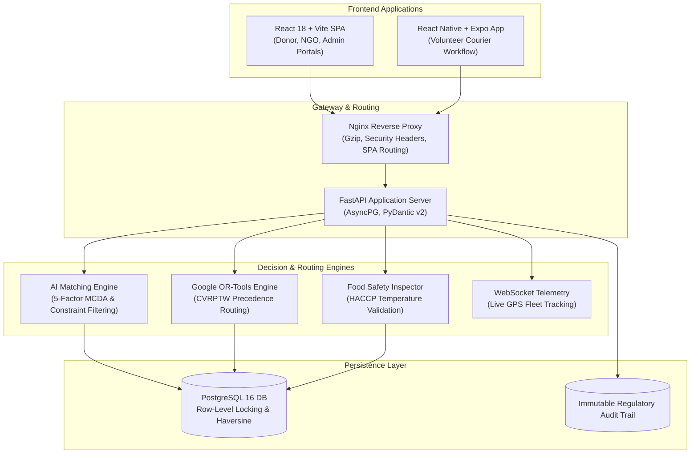

# LastPlate 🍽️ — Good Food Deserves a Second Chance

[](file:///Users/ravishankars/Desktop/lp/backend/tests)
[](https://fastapi.tiangolo.com)
[](https://vitejs.dev)
[](https://www.postgresql.org)
[](https://developers.google.com/optimization)
[](LICENSE)

> **LastPlate** is an enterprise-grade surplus food rescue platform connecting commercial kitchens, restaurants, and grocers with community shelters, soup kitchens, and food banks. Powered by Multi-Criteria Decision Analysis (MCDA) and Google OR-Tools Vehicle Routing, LastPlate delivers real-time matching, anti-collision claiming, courier route optimization, HACCP food-safety compliance, and verifiable ESG impact reporting.

---

## 🌟 Core Value Propositions

- ⚡ **Real-Time Surplus Matching**: Multi-factor MCDA engine computes ranked matches within 50ms based on distance decay, urgency, recipient storage, and dietary alignment.
- 🔒 **Collision-Free Atomic Claiming**: PostgreSQL row-level locks (`SELECT ... FOR UPDATE`) ensure zero double-booking across competing recipient claims.
- 🚚 **Optimized Fleet Routing**: Google OR-Tools solves Capacitated Vehicle Routing Problems with Time Windows (CVRPTW) enforcing collection-before-delivery precedence invariants.
- 🌡️ **HACCP & FDA Food Code Adherence**: Integrated temperature validation, allergen conflict prevention, and automatic safety quarantine holds for out-of-spec items.
- 📱 **Volunteer Mobile Companion**: Offline-resilient courier app with interactive GPS navigation, turn-by-turn guidance, and single-use QR/PIN handover verification.
- 📊 **ESG & Regulatory Audit Trail**: Immutable cryptographic audit log documenting every state transition, actor attribution, and verified metrics (meals rescued, kg diverted, CO₂ avoided).

---

## 🏛️ System Architecture



---

## 🚀 Quick Start Guide

### Option A: Docker Compose (Recommended)

Run the entire production-grade stack (PostgreSQL 16, FastAPI Backend, and React Frontend) with a single command:

```bash
# Clone the repository
git clone https://github.com/lastplate/lastplate.git
cd lastplate

# Launch full-stack container environment
docker compose up --build -d

# Verify services
docker compose ps
```

- **Web Application**: Open [http://localhost](http://localhost) (or [http://localhost:5173](http://localhost:5173))
- **Interactive OpenAPI Documentation**: Open [http://localhost:8000/docs](http://localhost:8000/docs)
- **Liveness & Readiness Probes**: [http://localhost:8000/api/v1/health](http://localhost:8000/api/v1/health) and [http://localhost:8000/api/v1/health/ready](http://localhost:8000/api/v1/health/ready)

---

### Option B: Local Development Setup

#### 1. Backend Service (FastAPI)
```bash
cd backend

# Create virtual environment and install dependencies
python3 -m venv venv
source venv/bin/activate
pip install -r requirements.txt

# Configure environment variables
cp .env.example .env

# Run database migrations and seed baseline data
alembic upgrade head
python -m app.db.seed

# Start development server
uvicorn app.main:app --reload --port 8000
```

#### 2. Web Frontend (React + Vite + Tailwind)
```bash
cd frontend

# Install dependencies and start Vite dev server
npm install
npm run dev
```

#### 3. Mobile Courier App (Expo / React Native)
```bash
cd mobile

# Install dependencies and launch Expo Metro bundler
npm install
npx expo start
```

---

## 🔑 Demo & Test Credentials

The database comes pre-seeded with verified test accounts across all roles:

| Role | Email Address | Password | Primary Capabilities |
|---|---|---|---|
| **Donor** | `chef@grandbistro.org` | `LastPlate#2026` | Post surplus food, declare temperatures & deadlines, inspect claim status |
| **NGO Recipient** | `director@hopeshelter.org` | `LastPlate#2026` | Browse ranked recommendations, atomically claim donations, receive verification PIN |
| **Volunteer Courier** | `priya.volunteer@gmail.com` | `LastPlate#2026` | Claim delivery jobs, navigate multi-stop routes, verify handovers with PIN |
| **Platform Admin** | `admin@lastplate.org` | `LastPlate#2026` | Trigger auto-dispatch, review quarantined donations, verify NGOs, audit logs |

---

## 🧪 Comprehensive Test Suite

LastPlate includes 70 automated integration, unit, and security audit tests with 100% pass rate:

```bash
# Run the entire test suite from the root directory
PYTHONPATH=backend backend/venv/bin/pytest backend/tests -v
```

### Key Test Coverage:
1. **End-to-End Lifecycle (`test_e2e_lifecycle.py`)**: Executes full donor post $\rightarrow$ AI matching $\rightarrow$ atomic claim $\rightarrow$ OR-Tools dispatch $\rightarrow$ volunteer navigation $\rightarrow$ temperature verification $\rightarrow$ audit trail $\rightarrow$ operational analytics.
2. **Security & RBAC Audit (`test_security_audit.py`)**: Tests hardened HTTP security headers, role least-privilege enforcement, forged JWT rejection, and SQL/XSS sanitization.
3. **Google OR-Tools VRP Solver (`test_route_optimizer.py`)**: Tests CVRPTW solver precedence invariants, vehicle weight limits, and over-capacity disjunction penalties.
4. **AI Matching Engine (`test_matching_engine.py`)**: Validates 5-factor scoring, hard-constraint filtering, and split-donation calculations.
5. **Real-Time Telemetry (`test_websockets.py`)**: Tests authenticated WebSocket connectivity, ping/pong heartbeats, GPS telemetry streams, and broadcast channels.

---

## 📖 Documentation Directory

- [Technical Architecture & System Design](file:///Users/ravishankars/Desktop/lp/docs/ARCHITECTURE.md)
- [Production Deployment & Operations Guide](file:///Users/ravishankars/Desktop/lp/docs/DEPLOYMENT.md)

---

## 📄 License

LastPlate is open-source software licensed under the [MIT License](LICENSE).
# lastplate-ai
