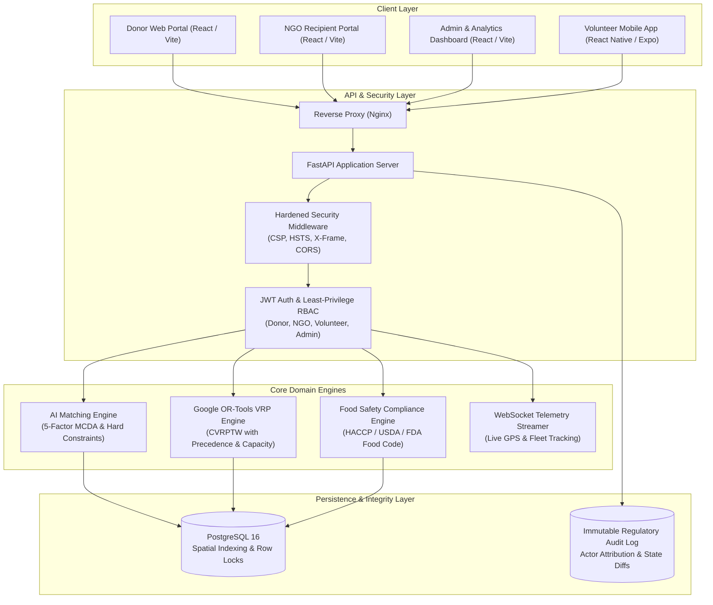
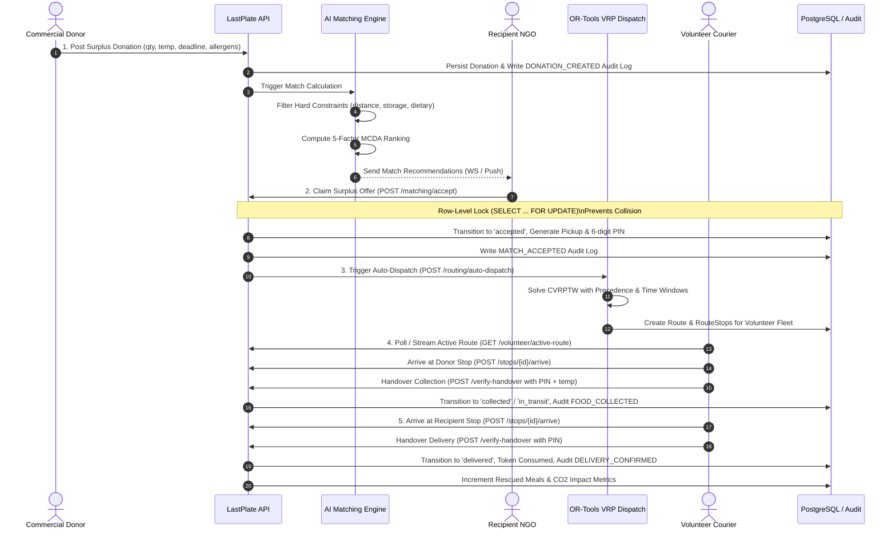

# LastPlate — Technical Architecture & System Design

> **"Good Food Deserves a Second Chance"**  
> *AI-Assisted Surplus Food Rescue, Real-Time Fleet Dispatch, and Verifiable Impact Platform.*

---

## 1. System Overview

LastPlate connects commercial food donors (restaurants, hotels, catering facilities, bakeries) with community recipient organizations (shelters, soup kitchens, food pantries) through a coordinated, multi-stakeholder platform.

### High-Level Architecture Diagram



---

## 2. Core Operational Flow & Lifecycle



---

## 3. Algorithmic Specifications

### 3.1 AI Multi-Criteria Decision Analysis (MCDA) Matching Engine

The matching engine matches active surplus food items to candidate recipient organizations through a two-stage pipeline:

#### Stage A: Hard Constraint Filtering
1. **Physical Proximity Cap:** Recipient organization must be within configured road/haversine radius (default: 25.0 km).
2. **Storage Compatibility:** Recipient must possess verified storage infrastructure matching donation condition:
   - `hot_holding` $\rightarrow$ Commercial hot cabinets / warming trays
   - `cold_holding` $\rightarrow$ Commercial refrigeration ($\le 4^\circ\text{C}$)
   - `frozen` $\rightarrow$ Deep freezer ($\le -18^\circ\text{C}$)
   - `ambient` $\rightarrow$ Dry, ventilated pantry
3. **Allergen & Dietary Compatibility:** Absolute exclusion of recipients that cannot accommodate declared allergens or dietary restrictions (e.g., Halal, Kosher, Vegetarian).
4. **Operating Window:** Recipient operating hours must overlap with donor pickup deadline.

#### Stage B: 5-Factor MCDA Scoring
For all surviving candidates, a composite suitability score $S \in [0, 100]$ is computed:

$$S = w_d \cdot S_{\text{dist}} + w_u \cdot S_{\text{urg}} + w_c \cdot S_{\text{cap}} + w_r \cdot S_{\text{rel}} + w_s \cdot S_{\text{safe}}$$

Where default production weights are:
- $w_d = 0.30$ (Distance Suitability: inverse decay over travel time)
- $w_u = 0.25$ (Urgency & Deadline Sensitivity: exponential ramp as expiry nears)
- $w_c = 0.20$ (Capacity Matching: ratio of portions requested vs available)
- $w_r = 0.15$ (Historical Reliability: on-time pickup acceptance track record)
- $w_s = 0.10$ (Dietary / Hygiene Preference alignment)

### 3.2 Google OR-Tools Vehicle Routing Problem (VRP) Engine

Dispatch routes are solved as a **Capacitated Vehicle Routing Problem with Time Windows (CVRPTW)** and **Pickup-and-Delivery Precedence Constraints**:
1. **Precedence Invariant:** For each surplus order $i$, Pickup Stop $P_i$ must strictly precede Delivery Stop $D_i$ on the same courier's route.
2. **Vehicle Capacity:** Cumulative weight and portion load carried by courier vehicle $k$ cannot exceed vehicle maximum capacity $C_k$ at any stop.
3. **Time Windows:** Couriers must arrive within specified collection windows and before recipient closing deadlines.
4. **Disjunctions & Drop Penalties:** If aggregate surplus exceeds fleet capacity, orders are penalized and held in the dispatch queue rather than causing solver failure.

---

## 4. Food Safety & Regulatory Protocol

### 4.1 Temperature Thresholds (HACCP & FDA Food Code)
- **Hot Holding:** Must remain $\ge 60.0^\circ\text{C}$ (140°F) from preparation through delivery.
- **Cold Holding:** Must remain $\le 5.0^\circ\text{C}$ (41°F) continuously.
- **2-Hour / 4-Hour Rule:** Cooked perishable food exposed to ambient temperatures is flagged for safety quarantine if pickup cannot occur within 4 hours.

### 4.2 Automated Safety Hold & Administrative Quarantine
If a donor posts food with out-of-spec temperatures (e.g., hot food at $52^\circ\text{C}$ or cold food at $9^\circ\text{C}$), the backend automatically triggers an immediate `SAFETY_HOLD`. The donation cannot be matched, claimed, or routed until an authorized Health & Safety Inspector or Platform Admin reviews the hazard mitigation plan and issues an explicit administrative release.

---

## 5. Security Architecture & Least-Privilege RBAC

### 5.1 Gateway Hardening
- `Content-Security-Policy`: Disallows unsafe inline scripts and untrusted external domains.
- `X-Content-Type-Options: nosniff`: Prevents MIME-sniffing exploits.
- `X-Frame-Options: SAMEORIGIN`: Blocks clickjacking attacks.
- `Referrer-Policy: strict-origin-when-cross-origin`: Minimizes information leakage.

### 5.2 Role-Based Access Control (RBAC) Matrix

| Endpoint Group | Donor | NGO Recipient | Volunteer | Administrator |
|---|:---:|:---:|:---:|:---:|
| `POST /donations` | ✅ | ❌ (403) | ❌ (403) | ✅ |
| `GET /matching/recommendations` | ❌ (403) | ✅ | ❌ (403) | ✅ |
| `POST /matching/accept` | ❌ (403) | ✅ | ❌ (403) | ✅ |
| `POST /routing/auto-dispatch` | ❌ (403) | ❌ (403) | ❌ (403) | ✅ |
| `GET /volunteer/active-route` | ❌ (403) | ❌ (403) | ✅ | ✅ |
| `POST /volunteer/verify-handover`| ❌ (403) | ❌ (403) | ✅ | ✅ |
| `GET /admin/analytics/overview` | ❌ (403) | ❌ (403) | ❌ (403) | ✅ |
| `POST /admin/organizations/verify`| ❌ (403) | ❌ (403) | ❌ (403) | ✅ |

### 5.3 Concurrency Control & Anti-Collision Locks
When an NGO accepts a donation offer, the transaction executes:
```sql
SELECT * FROM donations WHERE id = :donation_id FOR UPDATE;
```
If two NGO coordinators attempt to claim the same donation concurrently, the second transaction waits for the lock, observes that `status != 'available'`, and receives an immediate **409 Conflict** error.

---

## 6. Real-Time Telemetry & WebSocket Protocol

- `/api/v1/ws/{client_id}?token={jwt}`: Authenticated bidirectional WebSocket stream.
- Channels:
  - `system_status`: Broadcast platform events and global announcements.
  - `courier_telemetry`: Real-time GPS coordinate streaming ($1\text{ Hz}$) from active volunteer couriers to dispatch map.
  - `role_channel`: Targeted alerts for donors, NGOs, and volunteers.
